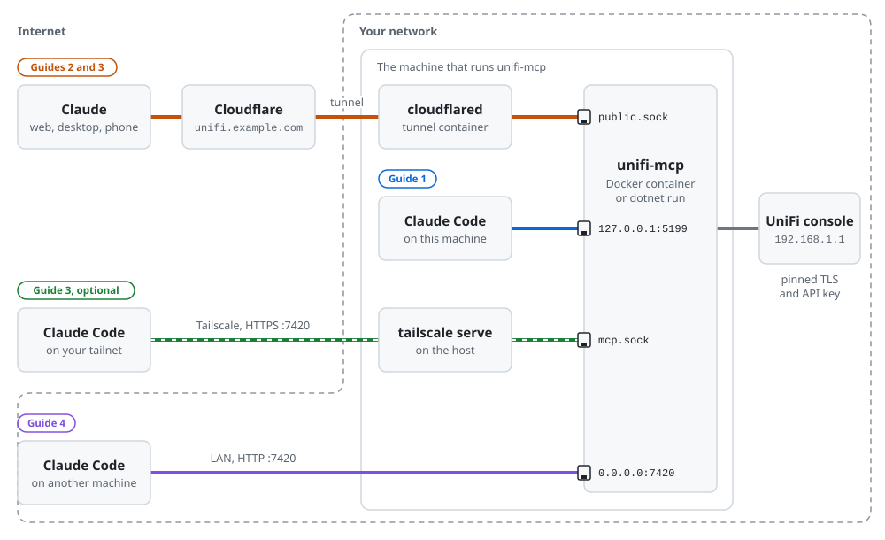
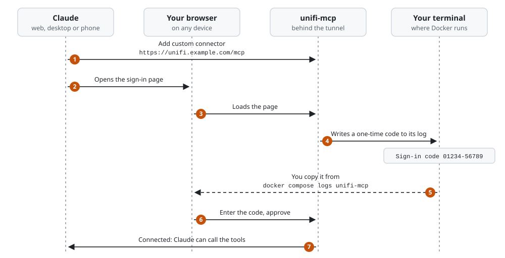

# UniFi Network MCP

An MCP server for the UniFi Network API (v11.0.97), generated from the OpenAPI document in `openapi/`. Built with .NET 10
and the official `ModelContextProtocol` SDK. It runs as a container next to your UniFi console and can be added to Claude
(claude.ai, Claude Desktop, the phone apps) as a custom connector. You sign in with a one-time code from the server's log
or with your Google account, and clients that send a fixed header can use an access token instead.

- All 73 API operations. The 41 reads run through one tool, `call_read_operation` (its `operation` lists them), which
  keeps the tool list short: Claude picks tools less well past 30 to 50. The 32 writes are a destructive tool each,
  listed only when writes are on. `search_operations` finds an operation and `describe_operation` shows its schema.
  Read-only, the server lists 15 tools; with writes on, 47.
- 4 task-oriented composites: `who_is_on_network_faq`, `client_path_faq`, `dhcp_reservation_faq`, `network_health_faq`.
- 6 read-only diagnostics the official API does not cover, from the console's internal API (the one its own UI uses):
  `system_log`, `internet_health_faq`, `wifi_health_faq`, `client_diagnostics_faq`, `device_diagnostics_faq`,
  `list_port_forwards`. They also give `client_path_faq` the switch port and `dhcp_reservation_faq` the fixed IP.
- 4 guide tools: `getting_started`, `unifi_status`, `search_operations`, `describe_operation`.

## Safety

- Read-only by default. Write tools exist only when `UNIFI_ALLOW_WRITES` is exactly `true`; each is marked destructive and
  needs `confirm` set to its own tool name, otherwise it returns a preview and sends nothing.
- TLS to the console uses a SHA-256 certificate pin. There is no default pin and no way to turn verification off.
- The API key comes from the `UNIFI_API_KEY` environment variable, falling back to `/config/unifi-api-key` only when the
  variable is unset or empty. It is never logged or returned, and is scrubbed from console errors.
- No published ports. The server listens on two Unix sockets:
  - `public.sock`, the Claude connector, reached through a Cloudflare tunnel. It takes OAuth bearer tokens, issued only
    after the owner signs in (see [guide 2](#guide-2-claudeai-with-a-sign-in-code) and [guide 3](#guide-3-full-setup-with-google-sign-in)), and, if you set one, the fixed `MCP_ACCESS_TOKEN`.
  - `mcp.sock`, optional tailnet access: reached through `tailscale serve`, which stamps `Tailscale-User-Login`; the server
    checks it against an allow-list. The public socket ignores that header.

- The internal API is reached only for a fixed list of reads (anything else is refused before a request is made, writes
  on or off), and is throttled: one request at a time, identical reads within 10 s served from cache, and at most 30
  calls a minute after a burst of 20. That API was not built for outside tools, and frequent polling of it can make a
  console drop packets. Its answers carry secrets (device keys, a maps API key), so these tools return chosen fields
  only, never the raw JSON.

Until the key and pin exist the server runs and reports "not configured" without contacting the console. Until the
connector is fully configured the public socket answers 503; the startup log line names what is missing (names only).

## Setup

There are three ways to run it. Pick the one that matches where you use Claude; each guide stands on its own.

<picture>
  <source media="(prefers-color-scheme: dark)" srcset="docs/images/setup-paths-dark.svg">
  
</picture>

| | [Guide 1: Quick local](#guide-1-quick-local-setup) | [Guide 2: claude.ai](#guide-2-claudeai-with-a-sign-in-code) | [Guide 3: Full](#guide-3-full-setup-with-google-sign-in) |
|---|---|---|---|
| Use it from | Claude Code on the same machine | claude.ai, Claude Desktop and the phone apps | Everything in guide 2, plus Claude Code anywhere on your tailnet |
| You need | The .NET 10 SDK | Docker Compose and a domain on Cloudflare (free plan is fine) | Guide 2, plus a Google Cloud project and, optionally, Tailscale |
| You sign in with | A name you allow, sent as a header | A one-time code from the server's log | A Google account on an allow-list |
| Reachable from the internet | No | Only through the Cloudflare tunnel | Only through the Cloudflare tunnel |

Placeholders used throughout: `192.168.1.1` is your console, `unifi.example.com` is the hostname you pick, and
`you@example.com` is your address.

### Before you start: two values from your console

Every guide needs these.

**The API key.** In UniFi Network, open Settings, Control Plane, Integrations and create an API key (the menu may move
between versions).

**The console's certificate fingerprint.** The console uses a self-signed certificate, so the server pins its SHA-256
fingerprint instead of trusting a CA. Read it from the network:

```sh
openssl s_client -connect 192.168.1.1:443 </dev/null 2>/dev/null | openssl x509 -noout -fingerprint -sha256
```

then confirm it on the console itself (SSH in and run
`openssl x509 -in /data/unifi-core/config/unifi-core.crt -noout -fingerprint -sha256`), so you are not pinning something
in the middle. Colons in the value are fine.

When the console regenerates its certificate (often after a firmware update), tool calls fail with "does not match the
pin" and name the fingerprint it presented. Confirm it on the console, update `UNIFI_CERT_SHA256`, and restart the server.

### Guide 1: Quick local setup

For Claude Code on the machine that runs the server. No domain, no tunnel, no sign-in page, and nothing listens beyond
`127.0.0.1`. Needs the [.NET 10 SDK](https://dotnet.microsoft.com/download).

1. Get the code and start the server, with the two values from [Before you start](#before-you-start-two-values-from-your-console):

   ```sh
   git clone https://github.com/Graf3x/unifi-mcp && cd unifi-mcp
   export UNIFI_URL=https://192.168.1.1
   export UNIFI_API_KEY='<your API key>'
   export UNIFI_CERT_SHA256='<the fingerprint>'
   export MCP_LISTEN=http://127.0.0.1:5199 MCP_ALLOW_LOOPBACK_TCP=true MCP_ALLOWED_LOGINS=me
   dotnet run --project src/UnifiMcp
   ```

   <details>
   <summary>The same in PowerShell</summary>

   ```powershell
   git clone https://github.com/Graf3x/unifi-mcp; cd unifi-mcp
   $env:UNIFI_URL = 'https://192.168.1.1'
   $env:UNIFI_API_KEY = '<your API key>'
   $env:UNIFI_CERT_SHA256 = '<the fingerprint>'
   $env:MCP_LISTEN = 'http://127.0.0.1:5199'; $env:MCP_ALLOW_LOOPBACK_TCP = 'true'; $env:MCP_ALLOWED_LOGINS = 'me'
   dotnet run --project src/UnifiMcp
   ```

   </details>

2. In a second terminal, add it to Claude Code. The header carries the name you allowed in `MCP_ALLOWED_LOGINS`:

   ```sh
   claude mcp add --transport http unifi http://127.0.0.1:5199/mcp --header "Tailscale-User-Login: me"
   ```

3. Ask Claude to call `getting_started`. It should say the server is configured.

The header's name comes from the tailnet setup, where Tailscale fills it in; here you send it yourself. Anything on this
machine that can reach `127.0.0.1:5199` and sends that name gets in, so use this mode on a machine only you use. The server
starts read-only; see [Writes](#writes).

### Guide 2: claude.ai with a sign-in code

Adds the server to Claude as a custom connector, so it works in claude.ai, Claude Desktop and the phone apps. Claude's
servers reach it through a Cloudflare tunnel: the tunnel container dials out, so you open no ports. You sign in with a
one-time code that the server writes to its own log, which proves you run the server; there is nothing else to set up.

You need a machine on the same network as the console with Docker and Docker Compose, and a domain on Cloudflare.

Each value in `.env` comes from one place. The striped ones are only for [guide 3](#guide-3-full-setup-with-google-sign-in):

<picture>
  <source media="(prefers-color-scheme: dark)" srcset="docs/images/env-values-dark.svg">
  
</picture>

#### Step 1: Get the files

```sh
git clone https://github.com/Graf3x/unifi-mcp && cd unifi-mcp
cp .env.example .env
mkdir -p data run
```

Only `docker-compose.yml` and `.env.example` are needed at run time if you would rather copy those two files. Create
`data` and `run` as yourself: the containers run as `PUID:PGID` from `.env` (your `id -u` / `id -g`) and must be able to
write there.

#### Step 2: Console values

Put the two values from [Before you start](#before-you-start-two-values-from-your-console) in `.env` as `UNIFI_API_KEY`
and `UNIFI_CERT_SHA256`, and set `UNIFI_URL` to the console's address (`https://192.168.1.1`).

#### Step 3: Cloudflare tunnel

In Cloudflare Zero Trust, Networks, Tunnels: create a Cloudflared tunnel and copy its token (the long value after
`--token` in the Docker command shown). Put it in `.env` as `TUNNEL_TOKEN`. The wizard waits for a connection; you can
leave it and come back under Networks, Tunnels.

On the tunnel, add a published application route (public hostname): `unifi.example.com`, Path empty, Service URL
`unix:/run/unifi-mcp/public.sock`, defaults otherwise.

Make sure nothing on that hostname asks for a login or a challenge: no Access application (watch for a wildcard such as
`*.example.com`), no WAF, bot-fight or challenge rule. Claude's servers cannot pass one.

#### Step 4: The rest of `.env`, then start

```sh
openssl rand -base64 32   # paste as UNIFI_MCP_DATA_KEY, once; keep it
```

Set `MCP_PUBLIC_BASE_URL=https://unifi.example.com`. Leave `MCP_SIGNIN=code` as `.env.example` has it.
`UNIFI_ALLOW_WRITES=false` keeps the server read-only; see [Writes](#writes). Every variable is described in
`.env.example`.

```sh
docker compose up -d
docker compose logs unifi-mcp
```

The startup line should read `configured, writes off, ... connector ready, sign-in code, access token off`. If it says
`not configured (...)` it lists what is still missing. `UNIFI_MCP_DATA_KEY` wraps the OAuth signing keys in `./data`: a
different value cannot open them (the connector answers 503 and nothing is overwritten). To start over, stop the app and
delete `./data`; every client then has to connect again.

#### Step 5: Add the connector in Claude

In Claude: Settings, Connectors, Add custom connector, URL `https://unifi.example.com/mcp`. Claude opens a sign-in page
in your browser, and the server writes a one-time code to its log as the page loads:

<picture>
  <source media="(prefers-color-scheme: dark)" srcset="docs/images/code-sign-in-dark.svg">
  
</picture>

Run `docker compose logs unifi-mcp`, look for `Sign-in code 01234-56789`, enter it and approve, then ask Claude to call
`getting_started`. A code works once, expires after 10 minutes, and is thrown away after 5 wrong tries; at most 10 new
codes are issued per hour.

Claude stays signed in (1-hour tokens refreshed in the background; a refresh token lasts 30 days from its last use).
`https://unifi.example.com/connections` lists connected clients, each with a Disconnect button, which is how you end
access.

#### Optional: a fixed access token

Some clients send a static header instead of signing in: Claude's connector dialog has a Request headers section (in beta
for some organisations), and Claude Code takes `--header`. Set `MCP_ACCESS_TOKEN` to a long random value
(`openssl rand -hex 32`, at least 32 characters) and send it as `Authorization: Bearer <token>` or `X-Api-Key: <token>`.
It works next to the sign-in, only on `/mcp`, and anyone holding it has the same access as you; to revoke it, change or
clear it and run `docker compose up -d`.

```sh
claude mcp add --transport http unifi https://unifi.example.com/mcp --header "Authorization: Bearer <token>"
```

### Guide 3: Full setup with Google sign-in

Everything in guide 2, but you sign in with a Google account on an allow-list instead of a code from the log, so
nobody needs access to the server to connect, and you can add a second way in for Claude Code over Tailscale. Do
[guide 2](#guide-2-claudeai-with-a-sign-in-code) steps 1 to 4 first, then:

#### Step 1: A Google OAuth client

In the Google Cloud Console:

1. Create a project.
2. Set the OAuth consent screen (Google Auth Platform) to External and publish it ("In production"). The basic scopes
   `openid email profile` need no review.
3. Create an OAuth client of type Web application with the authorised redirect URI
   `https://unifi.example.com/signin-google`.

#### Step 2: Switch the server to Google sign-in

In `.env`, set `MCP_SIGNIN=google`, put the client ID and secret in `GOOGLE_CLIENT_ID` and `GOOGLE_CLIENT_SECRET`, and
your address in `MCP_ALLOWED_GOOGLE_EMAILS` (comma separated for more than one). Then:

```sh
docker compose up -d
docker compose logs unifi-mcp   # the startup line now ends: sign-in google, access token off
```

Changing `MCP_SIGNIN` later signs everyone out and ends the connections made under the other mode; connect again.

#### Step 3: Connect in Claude

As in guide 2 step 5, but the sign-in page sends you to Google. Removing an address from `MCP_ALLOWED_GOOGLE_EMAILS`
(and running `docker compose up -d`) ends its access; Disconnect on `/connections` still works too.

#### Step 4 (optional): Claude Code over Tailscale

`./run/mcp.sock` serves the same tools to your tailnet, with no sign-in page: `tailscale serve` tells the server who is
calling. Set `MCP_ALLOWED_LOGINS` in `.env` to the Tailscale logins allowed, run `docker compose up -d`, then on the
host:

```sh
sudo tailscale serve --bg --https=7420 unix:$PWD/run/mcp.sock
claude mcp add --transport http unifi https://<machine>.<tailnet>.ts.net:7420/mcp
```

See `.mcp.json.example` for the project form.

### Updating

For guides 2 and 3:

```sh
docker compose pull && docker compose up -d
```

To build from your checkout instead of pulling the published image, uncomment `build: .` and `pull_policy: build` in
`docker-compose.yml`, then `docker compose up -d --build`. For guide 1, `git pull` and run `dotnet run` again.

### Troubleshooting

- Guide 1, 403 from `http://127.0.0.1:5199/mcp`: the `Tailscale-User-Login` header is missing, or its value is not in
  `MCP_ALLOWED_LOGINS`.
- 503 from `https://unifi.example.com/mcp`: the connector is not configured or its keys cannot be opened; the startup log
  line says why.
- 421: the request reached the server under another hostname. `MCP_PUBLIC_BASE_URL` must match the tunnel's public
  hostname exactly.
- The tunnel never connects: the host may be blocked from Cloudflare on outbound port 7844.
- "does not match the pin": the console has a new certificate; see [Before you start](#before-you-start-two-values-from-your-console).

## Writes

With `UNIFI_ALLOW_WRITES=true` the write tools appear; each still previews until called with `confirm` set to its own
name. Set it back to `false` and restart to make the server read-only.

## Owner's Fleet setup

<details>
<summary>How the owner runs it under Fleet. None of this is needed to run it yourself.</summary>

The owner runs this in their own homelab under Fleet, from the bundle in `deploy/` (`fleet.yaml`, `compose.yaml`,
`Dockerfile`, `SHA256SUMS`). Fleet builds it from checksummed source (`deploy/Dockerfile`, context `./build`), and
supplies values as owner keys set with `fleet-key`; the public hostname is set in `deploy/compose.yaml`. It uses Google sign-in (`MCP_SIGNIN` unset) and no access token. None of this is
needed to run it yourself. After changing anything under `src/UnifiMcp/`, regenerate `deploy/SHA256SUMS` from the repo
root and check it:

```sh
sha256sum -b $(git ls-files src/UnifiMcp | LC_ALL=C sort) > deploy/SHA256SUMS && sha256sum -c deploy/SHA256SUMS
```

### Who does what

Claude never sees key values and holds no Google or Cloudflare credentials. Everything below marked **owner** is the owner's
to run: every `fleet-key` command, the Google Cloud Console, the Cloudflare dashboard, deleting files in `config/`, and any
UniFi firewall change. Fleet releases (the owner's merge) gate each deploy.

### Owner setup (on fleet-mini)

The Network API key, the console's certificate pin, and the Google and Cloudflare values are owner keys set with
`fleet-key`. Allow-lists live in files in `/srv/fleet/apps/unifi-mcp/config` (run as a user with sudo).

```powershell
# The console's certificate SHA-256 (64 hex digits, colons allowed), after confirming it on the console:
#   ssh to the console, then: openssl x509 -in /data/unifi-core/config/unifi-core.crt -noout -fingerprint -sha256
.\fleet-key set UNIFI_CERT_SHA256
.\fleet-key allow UNIFI_CERT_SHA256 unifi-mcp
```

When the console regenerates its certificate, run `fleet-key set UNIFI_CERT_SHA256` again with the new fingerprint;
Fleet redeploys the app with the new value. `config/cert-sha256` still works as a fallback while the key is unset.

```sh
cd /srv/fleet/apps/unifi-mcp/config
# Tailscale logins allowed on the tailnet address, one per line.
echo 'you@example.com' | sudo tee allowed-logins >/dev/null
# Publish on the tailnet. 7420 is already open to tailnet admins in Fleet's ACL.
sudo tailscale serve --bg --https=7420 unix:/srv/fleet/apps/unifi-mcp/run/mcp.sock
```

Then, for Claude Code: `claude mcp add --transport http unifi https://fleet-mini.<tailnet>.ts.net:7420/mcp`.

Files are read on each use, so no restart is needed. Writes are on in `deploy/compose.yaml` (`UNIFI_ALLOW_WRITES: "true"`);
set it to `"false"` and redeploy to make the server read-only.

### Runbook: two stages

The keys arrive in two deploys, so a tailnet-only fix is never blocked on the Google or Cloudflare setup (Fleet refuses to
deploy an app that declares a key that is unset or not granted to it). `<host>` is the public hostname in
`deploy/compose.yaml`.

#### Stage 1: API key from Fleet, writes on, tailnet only (v0.2.0)

`fleet.yaml` declares `keys: [UNIFI_API_KEY]`; `compose.yaml` passes `UNIFI_API_KEY: ${UNIFI_API_KEY}` and sets
`UNIFI_ALLOW_WRITES: "true"`. `MCP_PUBLIC_BASE_URL` stays unset, so the public socket answers 503.

1. Owner: `fleet-key set UNIFI_API_KEY` (if not set yet), then `fleet-key allow UNIFI_API_KEY unifi-mcp`.
2. Deploy through Fleet (the owner merges the release). Check the logs for `configured, writes ON` and
   `connector not configured (...)`, and have Claude call `getting_started`: it should say configured.
3. Owner: delete `config/unifi-api-key`, then restart the app. The API key now comes only from the environment
   (the file is read only when `UNIFI_API_KEY` is unset or empty). Confirm the logs still say `configured`.

#### Stage 2: the connector

1. Owner, Google Cloud Console: as in step 1 of [guide 3](#step-1-a-google-oauth-client), with redirect URI
   `https://<host>/signin-google`. Store the client ID and secret with `fleet-key set GOOGLE_CLIENT_ID` and
   `fleet-key set GOOGLE_CLIENT_SECRET`, then `fleet-key allow` each for `unifi-mcp`.
2. Owner, Cloudflare Zero Trust: as in [guide 2 step 3](#step-3-cloudflare-tunnel), route `<host>` to
   `unix:/run/unifi-mcp/public.sock`. Store the token with `fleet-key set UNIFI_MCP_TUNNEL_TOKEN` and `fleet-key allow` it.
3. Owner: put your Google address in `config/allowed-google-emails`, one per line:
   `echo 'you@example.com' | sudo tee allowed-google-emails >/dev/null`.
4. Owner, only if the tunnel will not connect: fleet-mini may be blocked from Cloudflare on outbound port 7844. Opening it
   is a UniFi firewall change for the owner to approve.
5. Deploy 2 (the owner merges the release). It adds the three keys to `keys:`, `secrets: [UNIFI_MCP_DATA_KEY]` (Fleet
   generates it), `MCP_PUBLIC_BASE_URL`, `./data:/data` and the `cloudflared` sidecar. No ports are published.
6. In Claude: Settings, Connectors, Add custom connector, URL `https://<host>/mcp`. Sign in with Google, approve,
   and ask Claude to call `getting_started`.

#### Allow-list behaviour

- `config/allowed-google-emails` (one address per line) is re-read on every use. Removing an address ends access: the next
  refresh fails, and its sign-in cookie stops opening `/connections` and `/oauth/authorize` at once.
- Exception: if the file is empty or missing at startup, the connector reports "not configured" and stays that way until the
  app is restarted, even after you add an address.
- `MCP_ALLOWED_GOOGLE_EMAILS` (a comma or newline separated list) overrides the file. `MCP_ALLOWED_GOOGLE_EMAILS_FILE`
  moves the file.
- If `UNIFI_MCP_DATA_KEY` is missing or cannot open the existing keyring in `./data/keys`, or the Google keys or base URL are
  missing, the public socket refuses everything (503) and the log names what is wrong; the tailnet side keeps working.
  Nothing is regenerated over old keys.

</details>

## Develop

`dotnet test unifi-mcp.slnx`. Tests run against a fake UniFi handler; nothing here talks to a real console.
For a local run: `MCP_LISTEN=http://127.0.0.1:5199 MCP_ALLOW_LOOPBACK_TCP=true MCP_ALLOWED_LOGINS=you@example.com dotnet run --project src/UnifiMcp`.

Pushing a `v*` tag runs `.github/workflows/image.yml`: tests, then a multi-arch (amd64, arm64) image pushed to
`ghcr.io/<owner>/unifi-mcp` as the version, `<major>.<minor>` and `latest`. Bump `<Version>` in `src/UnifiMcp/UnifiMcp.csproj`
to match.

## Credits

Developed with [Claude Code](https://claude.com/claude-code) and Claude Opus 5.5, by [Anthropic](https://www.anthropic.com).

## License

[MIT](LICENSE)
