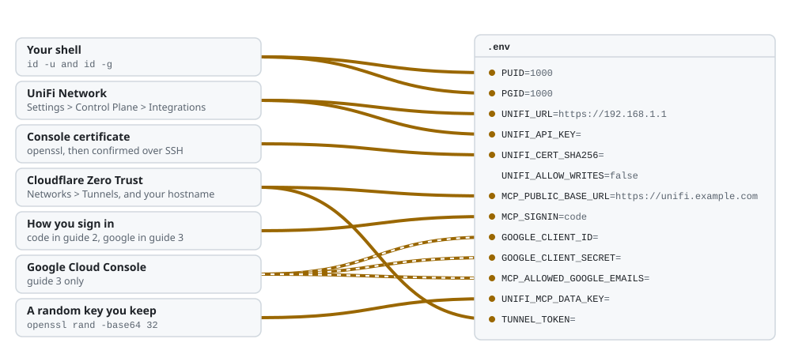

# UniFi Network MCP

[](https://github.com/Graf3x/unifi-mcp/actions/workflows/image.yml)
[](https://github.com/Graf3x/unifi-mcp/tags)
[](https://github.com/Graf3x/unifi-mcp/pkgs/container/unifi-mcp)
[](LICENSE)

Ask Claude about your UniFi network: who is connected, why the internet dropped last night, which switch port the
printer is on, which access point is fighting for a channel. This is an MCP server for the UniFi Network API that runs
next to your console, read-only unless you turn writes on.

It is built with .NET 10 and the official `ModelContextProtocol` SDK, from the UniFi Network API's OpenAPI document
(v11.0.97, in `openapi/`). Add it to Claude (claude.ai, Claude Desktop, the phone apps) as a custom connector, or to
Claude Code directly. You sign in with a one-time code from the server's log or with your Google account, and clients
that send a fixed header can use an access token instead.

<picture>
  <source media="(prefers-color-scheme: dark)" srcset="docs/images/setup-page-dark.png">
  
</picture>

The [setup page](#setup) shows the sign-in code the moment Claude asks for one, and tests every setting against the
real thing: here seven checks pass, and the tunnel check says what is wrong and which step fixes it.

**Contents:** [What you can ask](#what-you-can-ask), [Tools](#tools), [Safety](#safety), [Setup](#setup),
[Settings reference](#settings-reference), [FAQ](#faq), [Develop](#develop)

## What you can ask

| Ask Claude | It uses |
|---|---|
| Who is on the guest network right now? | `who_is_on_network_faq` |
| Which switch port is the office printer plugged into? | `client_path_faq` |
| Is the NAS getting the fixed IP I reserved for it? | `dhcp_reservation_faq` |
| Did the internet drop out this week, and how bad was the packet loss? | `internet_health_faq` |
| Are any access points on a busy or noisy channel? | `wifi_health_faq` |
| Do any switch ports show errors, drops or a flapping link? | `device_diagnostics_faq` |
| Why does my laptop keep losing Wi-Fi? | `client_diagnostics_faq`, `system_log` |
| Who signed in to the console in the last day? | `system_log` |
| Which devices are offline or have firmware updates waiting? | `network_health_faq` |
| What ports are forwarded to the internet? | `list_port_forwards` |
| With writes on: add a DNS record so `nas.home` points at 192.168.1.20 | `create_dns_policy`, after you approve it |

Anything else the API offers, Claude finds with `search_operations` and runs with `call_read_operation`.

## Tools

- All 73 API operations. The 41 reads run through one tool, `call_read_operation` (its `operation` lists them), which
  keeps the tool list short: Claude picks tools less well past 30 to 50. The 32 writes are a destructive tool each,
  listed only when writes are on. `search_operations` finds an operation and `describe_operation` shows its schema.
  Read-only, the server lists 15 tools; with writes on, 47.
- 4 task-oriented composites: `who_is_on_network_faq`, `client_path_faq`, `dhcp_reservation_faq`, `network_health_faq`.
- 6 read-only diagnostics the official API does not cover, from the console's internal API (the one its own UI uses):
  `system_log`, `internet_health_faq`, `wifi_health_faq`, `client_diagnostics_faq`, `device_diagnostics_faq`,
  `list_port_forwards`. They also give `client_path_faq` the switch port and `dhcp_reservation_faq` the fixed IP.
- `device_diagnostics_faq` also carries an interactive view for hosts that render MCP Apps, such as Claude's apps:
  a tile per device, and for one device a switch faceplate with each port's link, errors and what is connected to it.
  Other hosts, Claude Code among them, get the same answer as text. The view makes no writes and loads nothing from
  the network.
- 4 guide tools: `getting_started`, `unifi_status`, `search_operations`, `describe_operation`.

## Safety

- Read-only by default. Write tools exist only when `UNIFI_ALLOW_WRITES` is exactly `true`; each is marked destructive and
  asks you to approve it. A client that can show a confirmation form (MCP 2026-07-28 elicitation, as Claude Code does)
  shows you the whole change with Accept or Decline, and the model cannot approve it for you. A change too big to show
  whole is refused. Any other client is refused every write, unless you turn on the confirm fallback (see
  [Writes](#writes)).
- TLS to the console is pinned to a SHA-256 fingerprint of its certificate or public key, or, with `UNIFI_CERT_TRUST=ca`,
  checked against a trusted CA. There is no default pin and no way to turn verification off.
- The API key comes from the `UNIFI_API_KEY` environment variable, falling back to `/config/unifi-api-key` only when the
  variable is unset or empty. It is never logged or returned, and is scrubbed from console errors.
- No published ports unless you add the LAN listener. The server listens on two Unix sockets:
  - `public.sock`, the Claude connector, reached through a Cloudflare tunnel. It takes OAuth bearer tokens, issued only
    after the owner signs in (see [guide 2](#guide-2-claudeai-with-a-sign-in-code) and [guide 3](#guide-3-full-setup-with-google-sign-in)), and, if you set one, the fixed `MCP_ACCESS_TOKEN`.
  - `mcp.sock`, optional tailnet access: reached through `tailscale serve`, which stamps `Tailscale-User-Login`; the server
    checks it against an allow-list. The public socket ignores that header.
- The LAN listener ([guide 4](#guide-4-claude-code-across-your-lan)) is off unless `MCP_LAN_LISTEN` is set. It serves only
  `/mcp` and `/healthz`, accepts only `MCP_LAN_ACCESS_TOKEN` (never the public token, the sign-in or the Tailscale
  header), and the server won't start with it on and no token. It is plain HTTP; the startup log says so.
- The setup page (on unless you use Google sign-in) has a listener of its own, `127.0.0.1:5198` on the host, which the
  tunnel never reaches. It opens only from the link in the server's startup log, whose key changes on every start, so
  it shows the sign-in code to nobody who couldn't already read it in the log.

- The internal API is reached only through a fixed set of named reads (the server has no way to send it anything else,
  writes on or off), and is throttled: one request at a time, identical reads within 10 s served from cache, and at most 30
  calls a minute after a burst of 20. That API was not built for outside tools, and frequent polling of it can make a
  console drop packets. Its answers carry secrets (device keys, a maps API key), so these tools return chosen fields
  only, never the raw JSON.

Until the key and pin exist the server runs and reports "not configured" without contacting the console. Until the
connector is fully configured the public socket answers 503; the startup log line names what is missing (names only).

## Setup

There are four ways to run it. Pick the one that matches where you use Claude; each guide stands on its own.

<picture>
  <source media="(prefers-color-scheme: dark)" srcset="docs/images/setup-paths-dark.svg">
  
</picture>

| | [Guide 1: Quick local](#guide-1-quick-local-setup) | [Guide 2: claude.ai](#guide-2-claudeai-with-a-sign-in-code) | [Guide 3: Full](#guide-3-full-setup-with-google-sign-in) | [Guide 4: LAN](#guide-4-claude-code-across-your-lan) |
|---|---|---|---|---|
| Use it from | Claude Code on the same machine | claude.ai, Claude Desktop and the phone apps | Everything in guide 2, plus Claude Code anywhere on your tailnet | Claude Code on other machines on your network |
| You need | The .NET 10 SDK | Docker Compose and a domain on Cloudflare (free plan is fine) | Guide 2, plus a Google Cloud project and, optionally, Tailscale | Docker Compose |
| You sign in with | A name you allow, sent as a header | A one-time code from the server's log | A Google account on an allow-list | A token you generate, sent as a header |
| Reachable from the internet | No | Only through the Cloudflare tunnel | Only through the Cloudflare tunnel | Not if your router or firewall keeps port 7420 to the LAN: it is published on every host address |

Placeholders used throughout: `192.168.1.1` is your console, `192.168.1.20` is the machine that runs the server,
`unifi.example.com` is the hostname you pick, and `you@example.com` is your address.

**The setup page.** Once the server runs, its startup log prints a link: `Setup page: http://localhost:5198/setup?key=…`.
Open it in a browser on the same machine. It tests each setting against the real thing (the console, its certificate,
the API key, the tunnel, the sign-in) and says what to fix, shows the sign-in code as soon as Claude asks for one, and
carries these guides with your own values filled in. It is on in guides 1, 2 and 4; turn it off with `MCP_SETUP_PAGE=off`.
On a server without a browser, forward the port first: `ssh -L 5198:localhost:5198 you@server`.

### Before you start: two values from your console

Every guide needs these.

**The API key.** In UniFi Network, open Settings, Control Plane, Integrations and create an API key (the menu may move
between versions).

**The console's key fingerprint.** The console uses a self-signed certificate, so the server pins a SHA-256 fingerprint
instead of trusting a CA. Pin the certificate's public key: if the console re-issues its certificate with the same key,
the pin keeps working. Read it from the network:

```sh
openssl s_client -connect 192.168.1.1:443 </dev/null 2>/dev/null \
  | openssl x509 -pubkey -noout | openssl pkey -pubin -outform der | openssl dgst -sha256
```

then confirm it on the console itself, so you are not pinning something in the middle. SSH in and run
`openssl x509 -in /data/unifi-core/config/unifi-core.crt -pubkey -noout | openssl pkey -pubin -outform der | openssl dgst -sha256`.
The value goes in `UNIFI_CERT_SHA256`.

`UNIFI_CERT_SHA256` also accepts the fingerprint of the whole certificate (`openssl x509 -noout -fingerprint -sha256`;
colons are fine), and several fingerprints separated by commas.

**When the certificate changes.** A console can generate a new certificate, and sometimes a new key, after a firmware
update or a restart. Tool calls then fail with "does not match the pin" and name both fingerprints the console presented.
Confirm one on the console and add it to `UNIFI_CERT_SHA256` (the old and new can sit side by side, comma separated),
then restart the server. If the pin comes from the file `/config/cert-sha256` instead (with the variable unset), edit
the file: it is read on every new connection, so no restart is needed.

**Or: a certificate from a trusted CA.** If you give the console a certificate from a public CA such as Let's Encrypt,
set `UNIFI_CERT_TRUST=ca` and leave `UNIFI_CERT_SHA256` empty. The server then checks the certificate the usual way
(a valid chain, issued for the host name), so renewals need nothing from you. `UNIFI_URL` must use that host name
(`https://unifi.example.com`), and it must resolve to the console from where the server runs. UniFi OS 4.1 and later
can take your own certificate in its settings, under Control Plane, Console, Certificates (the menu may move between
versions). Tools such as [unifi-os-cert-deployer](https://github.com/mafredri/unifi-os-cert-deployer) automate issuing
and renewing one.

### Guide 1: Quick local setup

For Claude Code on the machine that runs the server. No domain, no tunnel, no sign-in page, and nothing listens beyond
`127.0.0.1`. Needs the [.NET 10 SDK](https://dotnet.microsoft.com/download).

1. Get the code and start the server, with the two values from [Before you start](#before-you-start-two-values-from-your-console):

   ```sh
   git clone https://github.com/Graf3x/unifi-mcp && cd unifi-mcp
   export UNIFI_URL=https://192.168.1.1
   export UNIFI_API_KEY='<your API key>'
   export UNIFI_CERT_SHA256='<the fingerprint>'
   export MCP_LISTEN=http://127.0.0.1:5199 MCP_ALLOW_LOOPBACK_TCP=true MCP_ALLOWED_LOGINS=me
   dotnet run --project src/UnifiMcp
   ```

   <details>
   <summary>The same in PowerShell</summary>

   ```powershell
   git clone https://github.com/Graf3x/unifi-mcp; cd unifi-mcp
   $env:UNIFI_URL = 'https://192.168.1.1'
   $env:UNIFI_API_KEY = '<your API key>'
   $env:UNIFI_CERT_SHA256 = '<the fingerprint>'
   $env:MCP_LISTEN = 'http://127.0.0.1:5199'; $env:MCP_ALLOW_LOOPBACK_TCP = 'true'; $env:MCP_ALLOWED_LOGINS = 'me'
   dotnet run --project src/UnifiMcp
   ```

   </details>

2. In a second terminal, add it to Claude Code. The header carries the name you allowed in `MCP_ALLOWED_LOGINS`:

   ```sh
   claude mcp add --transport http unifi http://127.0.0.1:5199/mcp --header "Tailscale-User-Login: me"
   ```

3. Ask Claude to call `getting_started`. It should say the server is configured. If not, open the `Setup page:` link
   the server printed when it started; its checks say what is wrong.

The header's name comes from the tailnet setup, where Tailscale fills it in; here you send it yourself. Anything on this
machine that can reach `127.0.0.1:5199` and sends that name gets in, so use this mode on a machine only you use. The server
starts read-only; see [Writes](#writes).

### Guide 2: claude.ai with a sign-in code

Adds the server to Claude as a custom connector, so it works in claude.ai, Claude Desktop and the phone apps. Claude's
servers reach it through a Cloudflare tunnel: the tunnel container dials out, so you open no ports. You sign in with a
one-time code that the server writes to its own log, which proves you run the server; there is nothing else to set up.

You need a machine on the same network as the console with Docker and Docker Compose, and a domain on Cloudflare.

Each value in `.env` comes from one place. The striped ones are only for [guide 3](#guide-3-full-setup-with-google-sign-in):

<picture>
  <source media="(prefers-color-scheme: dark)" srcset="docs/images/env-values-dark.svg">
  
</picture>

#### Step 1: Get the files

```sh
git clone https://github.com/Graf3x/unifi-mcp && cd unifi-mcp
cp .env.example .env
mkdir -p data run
```

Only `docker-compose.yml` and `.env.example` are needed at run time if you would rather copy those two files. Create
`data` and `run` as yourself: the containers run as `PUID:PGID` from `.env` (your `id -u` / `id -g`) and must be able to
write there.

#### Step 2: Console values

Put the two values from [Before you start](#before-you-start-two-values-from-your-console) in `.env` as `UNIFI_API_KEY`
and `UNIFI_CERT_SHA256`, and set `UNIFI_URL` to the console's address (`https://192.168.1.1`).

#### Step 3: Cloudflare tunnel

In Cloudflare Zero Trust, Networks, Tunnels: create a Cloudflared tunnel and copy its token (the long value after
`--token` in the Docker command shown). Put it in `.env` as `TUNNEL_TOKEN`. The wizard waits for a connection; you can
leave it and come back under Networks, Tunnels.

On the tunnel, add a published application route (public hostname): `unifi.example.com`, Path empty, Service URL
`unix:/run/unifi-mcp/public.sock`, defaults otherwise.

Make sure nothing on that hostname asks for a login or a challenge: no Access application (watch for a wildcard such as
`*.example.com`), no WAF, bot-fight or challenge rule. Claude's servers cannot pass one.

#### Step 4: The rest of `.env`, then start

```sh
openssl rand -base64 32   # paste as UNIFI_MCP_DATA_KEY, once; keep it
```

Set `MCP_PUBLIC_BASE_URL=https://unifi.example.com`. Leave `MCP_SIGNIN=code` as `.env.example` has it.
`UNIFI_ALLOW_WRITES=false` keeps the server read-only; see [Writes](#writes). Every variable is described in
`.env.example`.

```sh
docker compose up -d
docker compose logs unifi-mcp
```

The startup line should read `configured, writes off, ... connector ready, sign-in code, access token off`. If it says
`not configured (...)` it lists what is still missing. The next line is the `Setup page:` link: open it to test every
value, including the tunnel from the outside. `UNIFI_MCP_DATA_KEY` wraps the OAuth signing keys in `./data`: a
different value cannot open them (the connector answers 503 and nothing is overwritten). To start over, stop the app and
delete `./data`; every client then has to connect again.

#### Step 5: Add the connector in Claude

In Claude: Settings, Connectors, Add custom connector, URL `https://unifi.example.com/mcp`. Claude opens a sign-in page
in your browser, and the server writes a one-time code to its log as the page loads:

<picture>
  <source media="(prefers-color-scheme: dark)" srcset="docs/images/code-sign-in-dark.svg">
  
</picture>

The code also shows on the setup page the moment the sign-in page loads, so with that page open you don't need the log.
Otherwise run `docker compose logs unifi-mcp` and look for `Sign-in code 01234-56789`. Enter it and approve, then ask
Claude to call `getting_started`. A code works once, expires after 10 minutes, and is thrown away after 5 wrong tries; at most 10 new
codes are issued per hour.

Claude stays signed in (1-hour tokens refreshed in the background; a refresh token lasts 30 days from its last use).
`https://unifi.example.com/connections` lists connected clients, each with a Disconnect button, which is how you end
access.

#### Optional: a fixed access token

Some clients send a static header instead of signing in: Claude's connector dialog has a Request headers section (in beta
for some organisations), and Claude Code takes `--header`. Set `MCP_ACCESS_TOKEN` to a long random value
(`openssl rand -hex 32`, at least 32 characters) and send it as `Authorization: Bearer <token>` or `X-Api-Key: <token>`.
It works next to the sign-in, only on `/mcp`, and anyone holding it has the same access as you; to revoke it, change or
clear it and run `docker compose up -d`.

```sh
claude mcp add --transport http unifi https://unifi.example.com/mcp --header "Authorization: Bearer <token>"
```

### Guide 3: Full setup with Google sign-in

Everything in guide 2, but you sign in with a Google account on an allow-list instead of a code from the log, so
nobody needs access to the server to connect, and you can add a second way in for Claude Code over Tailscale. Do
[guide 2](#guide-2-claudeai-with-a-sign-in-code) steps 1 to 4 first, then:

#### Step 1: A Google OAuth client

In the Google Cloud Console:

1. Create a project.
2. Set the OAuth consent screen (Google Auth Platform) to External and publish it ("In production"). The basic scopes
   `openid email profile` need no review.
3. Create an OAuth client of type Web application with the authorised redirect URI
   `https://unifi.example.com/signin-google`.

#### Step 2: Switch the server to Google sign-in

In `.env`, set `MCP_SIGNIN=google`, put the client ID and secret in `GOOGLE_CLIENT_ID` and `GOOGLE_CLIENT_SECRET`, and
your address in `MCP_ALLOWED_GOOGLE_EMAILS` (comma separated for more than one). Then:

```sh
docker compose up -d
docker compose logs unifi-mcp   # the startup line now ends: sign-in google, access token off
```

Changing `MCP_SIGNIN` later signs everyone out and ends the connections made under the other mode; connect again.

#### Step 3: Connect in Claude

As in guide 2 step 5, but the sign-in page sends you to Google. Removing an address from `MCP_ALLOWED_GOOGLE_EMAILS`
(and running `docker compose up -d`) ends its access; Disconnect on `/connections` still works too.

#### Step 4 (optional): Claude Code over Tailscale

`./run/mcp.sock` serves the same tools to your tailnet, with no sign-in page: `tailscale serve` tells the server who is
calling. Set `MCP_ALLOWED_LOGINS` in `.env` to the Tailscale logins allowed, run `docker compose up -d`, then on the
host:

```sh
sudo tailscale serve --bg --https=7420 unix:$PWD/run/mcp.sock
claude mcp add --transport http unifi https://<machine>.<tailnet>.ts.net:7420/mcp
```

See `.mcp.json.example` for the project form.

### Guide 4: Claude Code across your LAN

For a server on your home network (a NAS, a mini PC) and Claude Code on other machines on the same network. No domain,
no tunnel and no Tailscale: the server opens a listener on your network that accepts one token. Needs Docker and Docker
Compose.

1. Get the files and make a token:

   ```sh
   git clone https://github.com/Graf3x/unifi-mcp && cd unifi-mcp
   cp .env.example .env
   mkdir -p data run
   openssl rand -hex 32   # paste as MCP_LAN_ACCESS_TOKEN
   ```

   In `.env`, set `UNIFI_URL`, `UNIFI_API_KEY` and `UNIFI_CERT_SHA256` from
   [Before you start](#before-you-start-two-values-from-your-console), and `MCP_LAN_ACCESS_TOKEN` to the value you made.
   Leave `MCP_PUBLIC_BASE_URL` and `TUNNEL_TOKEN` empty. Only `docker-compose.lan.yml` and `.env.example` are needed at
   run time if you would rather copy those two files.

2. Start it with the LAN compose file:

   ```sh
   docker compose -f docker-compose.lan.yml up -d
   docker compose -f docker-compose.lan.yml logs unifi-mcp
   ```

   The startup line ends in `LAN http://0.0.0.0:7420`, followed by a reminder that the listener is plain HTTP. Open the
   `Setup page:` link: it checks the console values and shows the command for the next step.

3. On each machine that runs Claude Code, add the server with its address and the token:

   ```sh
   claude mcp add --transport http unifi http://192.168.1.20:7420/mcp --header "Authorization: Bearer <token>"
   ```

   Then ask Claude to call `getting_started`. Any client that speaks MCP over Streamable HTTP and can send a header works
   the same way; `X-Api-Key: <token>` is accepted too.

The listener serves `/mcp` and `/healthz` and nothing else, and accepts only `MCP_LAN_ACCESS_TOKEN`; the server refuses to
start without one. It is plain HTTP, so anyone who can see your network's traffic can read the token, and anyone with the
token has the same access as you. Docker publishes port 7420 on every address of the host, so if the host has an
address the internet can route to, make sure your router or firewall blocks inbound traffic to it. Use it on a network
you trust, limit port 7420 to the machines that need it if your firewall can, or put a TLS proxy in front. To revoke the token, change it in `.env` and run
`docker compose -f docker-compose.lan.yml up -d`.

Already running guide 2 or 3? Add the listener to `docker-compose.yml` instead: set `MCP_LAN_ACCESS_TOKEN` in `.env` and
uncomment the `MCP_LAN_LISTEN` and `7420:7420` lines. Its token must differ from `MCP_ACCESS_TOKEN`, so the one that
crosses your network in plain HTTP never opens the internet-facing connector.

### Updating

For guides 2, 3 and 4 (add `-f docker-compose.lan.yml` to both commands for guide 4):

```sh
docker compose pull && docker compose up -d
```

To build from your checkout instead of pulling the published image, uncomment `build: .` and `pull_policy: build` in
`docker-compose.yml`, then `docker compose up -d --build`. For guide 1, `git pull` and run `dotnet run` again.

### Troubleshooting

- Guide 1, 403 from `http://127.0.0.1:5199/mcp`: the `Tailscale-User-Login` header is missing, or its value is not in
  `MCP_ALLOWED_LOGINS`.
- 503 from `https://unifi.example.com/mcp`: the connector is not configured or its keys cannot be opened; the startup log
  line says why.
- Guide 4, 401 from `http://192.168.1.20:7420/mcp`: the header is missing, or its token isn't `MCP_LAN_ACCESS_TOKEN`
  (`MCP_ACCESS_TOKEN` is not accepted there). No answer at all: the port isn't published, or a firewall is in the way.
- `docker ps` shows the container as unhealthy: the server doesn't answer `/healthz` on `mcp.sock`. The image checks it
  every 30 seconds with `dotnet unifi-mcp.dll --healthcheck`; it tells whether the server is up, not whether it is
  configured (the setup page says that).
- 421: the request reached the server under another hostname. `MCP_PUBLIC_BASE_URL` must match the tunnel's public
  hostname exactly.
- The tunnel never connects: the host may be blocked from Cloudflare on outbound port 7844.
- Start with the setup page: its checks name most of the problems below and link to the step that fixes each.
- The setup page says it is locked: open the `Setup page:` link from the server's latest start. The key changes each
  time the server starts.
- 421 from the setup page: open it as `localhost` or by IP address (`http://192.168.1.20:5198`), not by a host
  name; that refusal is what keeps other sites from reaching it through DNS tricks.
- "does not match the pin": the console has a new certificate; see [Before you start](#before-you-start-two-values-from-your-console).
- "not trusted" with `UNIFI_CERT_TRUST=ca`: the console's certificate is not from a CA the server trusts, has expired, or was not
  issued for the host in `UNIFI_URL`; the message says which.

## Writes

With `UNIFI_ALLOW_WRITES=true` the write tools appear. Each asks you first, on a confirmation form that shows the whole
change: the request and every field of its body. You click Accept or Decline; the model cannot answer for you. A change
too big for the form (over 10,000 characters) is refused and nothing is sent, so Claude has to make it in smaller steps.

The form needs a client on MCP revision 2026-07-28 that declares form elicitation. A client without it is refused every
write. If yours cannot show the form and you still want writes there, set `UNIFI_ALLOW_CONFIRM_FALLBACK=true`. Then such a
client gets a preview, and the write is sent when the model calls the tool again with `confirm` set to the tool's own name.
Know what that means: the model sets `confirm` itself, so on that client the model approves its own writes. Nothing
checks that you saw the preview or said yes. Turn it on only if you trust the model, and what it reads, with your network.
Clients that can show the form still get it, and ignore `confirm`.

The audit log says how each change was approved, or why it was refused. Set `UNIFI_ALLOW_WRITES` back to `false` and
restart to make the server read-only.

## Settings reference

All settings come from the environment (`.env` with Docker Compose). After changing one, run `docker compose up -d`.

| Variable | Default | What it does |
|---|---|---|
| `UNIFI_URL` | `https://192.168.1.1` | The console's address as the server reaches it. https only. |
| `UNIFI_SITE` | `default` | The site tools use when they don't name one. |
| `UNIFI_API_KEY` | none | Network API key ([Before you start](#before-you-start-two-values-from-your-console)). |
| `UNIFI_CERT_SHA256` | none | Pinned fingerprints of the console's public key or certificate, comma separated. |
| `UNIFI_CERT_TRUST` | `pin` | `ca` checks a CA-issued certificate instead of a pin. |
| `UNIFI_ALLOW_WRITES` | `false` | Exactly `true` lists the write tools; see [Writes](#writes). |
| `UNIFI_ALLOW_CONFIRM_FALLBACK` | `false` | Exactly `true` lets a client that cannot show the confirmation form write with `confirm`, so the model approves its own writes there; see [Writes](#writes). |
| `MCP_PUBLIC_BASE_URL` | none | The connector's public origin, e.g. `https://unifi.example.com`. |
| `MCP_SIGNIN` | `google` | `code` or `google`; `.env.example` sets `code`. |
| `GOOGLE_CLIENT_ID`, `GOOGLE_CLIENT_SECRET` | none | Google OAuth web client, for `google` sign-in. |
| `MCP_ALLOWED_GOOGLE_EMAILS` | none | Google addresses allowed to sign in, comma separated. |
| `MCP_ACCESS_TOKEN` | none | Optional fixed token for clients that send a header; at least 32 characters. |
| `MCP_LAN_ACCESS_TOKEN` | none | The only token the LAN listener ([guide 4](#guide-4-claude-code-across-your-lan)) accepts; at least 32 characters, not the same as `MCP_ACCESS_TOKEN`. |
| `UNIFI_MCP_DATA_KEY` | none | Wraps the connector's signing keys in `./data`. Generate once and keep it. |
| `MCP_ALLOWED_LOGINS` | none | Logins allowed on the tailnet socket, or in [guide 1](#guide-1-quick-local-setup). |
| `TUNNEL_TOKEN` | none | Read by the `cloudflared` container, not the server. |
| `PUID`, `PGID` | `1000` | The user and group the containers run as. |
| `MCP_SETUP_PAGE` | on, except with Google sign-in and a public URL | `off` turns the setup page off; `on` turns it on in guide 3. |

<details>
<summary>Advanced: files and listeners</summary>

| Variable | Default | What it does |
|---|---|---|
| `UNIFI_API_KEY_FILE` | `/config/unifi-api-key` | Read when `UNIFI_API_KEY` is empty. |
| `UNIFI_CERT_SHA256_FILE` | `/config/cert-sha256` | Read when `UNIFI_CERT_SHA256` is empty; re-read on each new connection. |
| `MCP_ALLOWED_LOGINS_FILE` | `/config/allowed-logins` | Read when `MCP_ALLOWED_LOGINS` is empty. |
| `MCP_ALLOWED_GOOGLE_EMAILS_FILE` | `/config/allowed-google-emails` | Read when `MCP_ALLOWED_GOOGLE_EMAILS` is empty. |
| `MCP_LISTEN` | `unix:/run/unifi-mcp/mcp.sock` | The tailnet listener. A TCP address is refused unless it is loopback and `MCP_ALLOW_LOOPBACK_TCP=true`. |
| `MCP_PUBLIC_LISTEN` | `unix:/run/unifi-mcp/public.sock` | The connector's listener. |
| `MCP_ALLOW_LOOPBACK_TCP` | `false` | Allows a loopback `MCP_LISTEN`, as in guide 1. |
| `MCP_DATA_DIR` | `/data` | Where the connector keeps its sign-in store and keys. |
| `MCP_LAN_LISTEN` | off | The token-only LAN listener: an IP address and a port, e.g. `http://0.0.0.0:7420`. Serves `/mcp` and `/healthz` over plain HTTP; needs `MCP_LAN_ACCESS_TOKEN`. `docker-compose.lan.yml` sets it. |
| `MCP_SETUP_LISTEN` | `http://127.0.0.1:5198` | The setup page's own listener: an IP address (or `localhost`) and a port. `docker-compose.yml` sets `http://0.0.0.0:5198` in the container and publishes it on the host's `127.0.0.1` only. |

</details>

## FAQ

**Does it need a UI.com account or cloud access?** No. The server talks to the console over your network with a local
API key. Claude reaches the server only the way you set up: locally, through your Cloudflare tunnel, over Tailscale, or
over your LAN with a token.

**Can Claude change my network?** Only if you set `UNIFI_ALLOW_WRITES=true`. Even then each change asks you first, on a
confirmation form where you see the whole change and click Accept or Decline yourself. A client that cannot show the form
cannot write at all, unless you also set `UNIFI_ALLOW_CONFIRM_FALLBACK=true`; then Claude approves its own writes there
with `confirm`, as [Writes](#writes) explains.

**Will it slow the console down?** The official API is made for this. The diagnostics tools also read the console's
internal API, which is not, so those calls are limited to 30 a minute and repeats within 10 seconds come from a cache.

**Does it keep my network data?** No. `./data` holds only the connector's sign-in records and keys, the keys wrapped with
`UNIFI_MCP_DATA_KEY`. Console answers go to Claude in the conversation; the diagnostics tools leave out the secrets the
internal API returns, such as device keys.

**I have several sites.** Every tool takes `siteId` (a UUID or a site name); `UNIFI_SITE` sets the default.

**Which UniFi versions work?** It is built against UniFi Network's Integration API 11.0.97 and tested on UniFi Network 11.
The diagnostics use internal endpoints Ubiquiti can change without notice; if one moves, that tool says so and the rest
keep working.

**Can I use another MCP client?** Yes, any client that speaks MCP over Streamable HTTP. With guide 1, guide 4, Tailscale
or the access token it only needs to send a header.

## Owner's Fleet setup

<details>
<summary>How the owner runs it under Fleet. None of this is needed to run it yourself.</summary>

The owner runs this in their own homelab under Fleet, from the bundle in `deploy/` (`fleet.yaml`, `compose.yaml`,
`Dockerfile`, `SHA256SUMS`). Fleet builds it from checksummed source (`deploy/Dockerfile`, context `./build`), and
supplies values as owner keys set with `fleet-key`; the public hostname is set in `deploy/compose.yaml`. It uses Google sign-in (`MCP_SIGNIN` unset) and no access token. None of this is
needed to run it yourself. After changing anything under `src/UnifiMcp/`, regenerate `deploy/SHA256SUMS` from the repo
root and check it:

```sh
sha256sum -b $(git ls-files src/UnifiMcp | LC_ALL=C sort) > deploy/SHA256SUMS && sha256sum -c deploy/SHA256SUMS
```

### Who does what

Claude never sees key values and holds no Google or Cloudflare credentials. Everything below marked **owner** is the owner's
to run: every `fleet-key` command, the Google Cloud Console, the Cloudflare dashboard, deleting files in `config/`, and any
UniFi firewall change. Fleet releases (the owner's merge) gate each deploy.

### Owner setup (on fleet-mini)

The Network API key, the console's certificate pin, and the Google and Cloudflare values are owner keys set with
`fleet-key`. Allow-lists live in files in `/srv/fleet/apps/unifi-mcp/config` (run as a user with sudo).

```powershell
# The console's certificate SHA-256 (64 hex digits, colons allowed), after confirming it on the console:
#   ssh to the console, then: openssl x509 -in /data/unifi-core/config/unifi-core.crt -noout -fingerprint -sha256
.\fleet-key set UNIFI_CERT_SHA256
.\fleet-key allow UNIFI_CERT_SHA256 unifi-mcp
```

When the console regenerates its certificate, run `fleet-key set UNIFI_CERT_SHA256` again with the new fingerprint (or the
old and new, comma separated);
Fleet redeploys the app with the new value. `config/cert-sha256` still works as a fallback while the key is unset.

```sh
cd /srv/fleet/apps/unifi-mcp/config
# Tailscale logins allowed on the tailnet address, one per line.
echo 'you@example.com' | sudo tee allowed-logins >/dev/null
# Publish on the tailnet. 7420 is already open to tailnet admins in Fleet's ACL.
sudo tailscale serve --bg --https=7420 unix:/srv/fleet/apps/unifi-mcp/run/mcp.sock
```

Then, for Claude Code: `claude mcp add --transport http unifi https://fleet-mini.<tailnet>.ts.net:7420/mcp`.

Files are read on each use, so no restart is needed. Writes are on in `deploy/compose.yaml` (`UNIFI_ALLOW_WRITES: "true"`);
set it to `"false"` and redeploy to make the server read-only. `UNIFI_ALLOW_CONFIRM_FALLBACK` is not set there, so only a
client that can show the confirmation form can write.

### Runbook: two stages

The keys arrive in two deploys, so a tailnet-only fix is never blocked on the Google or Cloudflare setup (Fleet refuses to
deploy an app that declares a key that is unset or not granted to it). `<host>` is the public hostname in
`deploy/compose.yaml`.

#### Stage 1: API key from Fleet, writes on, tailnet only (v0.2.0)

`fleet.yaml` declares `keys: [UNIFI_API_KEY]`; `compose.yaml` passes `UNIFI_API_KEY: ${UNIFI_API_KEY}` and sets
`UNIFI_ALLOW_WRITES: "true"`. `MCP_PUBLIC_BASE_URL` stays unset, so the public socket answers 503.

1. Owner: `fleet-key set UNIFI_API_KEY` (if not set yet), then `fleet-key allow UNIFI_API_KEY unifi-mcp`.
2. Deploy through Fleet (the owner merges the release). Check the logs for `configured, writes ON` and
   `connector not configured (...)`, and have Claude call `getting_started`: it should say configured.
3. Owner: delete `config/unifi-api-key`, then restart the app. The API key now comes only from the environment
   (the file is read only when `UNIFI_API_KEY` is unset or empty). Confirm the logs still say `configured`.

#### Stage 2: the connector

1. Owner, Google Cloud Console: as in step 1 of [guide 3](#step-1-a-google-oauth-client), with redirect URI
   `https://<host>/signin-google`. Store the client ID and secret with `fleet-key set GOOGLE_CLIENT_ID` and
   `fleet-key set GOOGLE_CLIENT_SECRET`, then `fleet-key allow` each for `unifi-mcp`.
2. Owner, Cloudflare Zero Trust: as in [guide 2 step 3](#step-3-cloudflare-tunnel), route `<host>` to
   `unix:/run/unifi-mcp/public.sock`. Store the token with `fleet-key set UNIFI_MCP_TUNNEL_TOKEN` and `fleet-key allow` it.
3. Owner: put your Google address in `config/allowed-google-emails`, one per line:
   `echo 'you@example.com' | sudo tee allowed-google-emails >/dev/null`.
4. Owner, only if the tunnel will not connect: fleet-mini may be blocked from Cloudflare on outbound port 7844. Opening it
   is a UniFi firewall change for the owner to approve.
5. Deploy 2 (the owner merges the release). It adds the three keys to `keys:`, `secrets: [UNIFI_MCP_DATA_KEY]` (Fleet
   generates it), `MCP_PUBLIC_BASE_URL`, `./data:/data` and the `cloudflared` sidecar. No ports are published.
6. In Claude: Settings, Connectors, Add custom connector, URL `https://<host>/mcp`. Sign in with Google, approve,
   and ask Claude to call `getting_started`.

#### Allow-list behaviour

- `config/allowed-google-emails` (one address per line) is re-read on every use. Removing an address ends access: the next
  refresh fails, and its sign-in cookie stops opening `/connections` and `/oauth/authorize` at once.
- Exception: if the file is empty or missing at startup, the connector reports "not configured" and stays that way until the
  app is restarted, even after you add an address.
- `MCP_ALLOWED_GOOGLE_EMAILS` (a comma or newline separated list) overrides the file. `MCP_ALLOWED_GOOGLE_EMAILS_FILE`
  moves the file.
- If `UNIFI_MCP_DATA_KEY` is missing or cannot open the existing keyring in `./data/keys`, or the Google keys or base URL are
  missing, the public socket refuses everything (503) and the log names what is wrong; the tailnet side keeps working.
  Nothing is regenerated over old keys.

</details>

## Develop

`dotnet test unifi-mcp.slnx`. Tests run against a fake UniFi handler; nothing here talks to a real console.
For a local run: `MCP_LISTEN=http://127.0.0.1:5199 MCP_ALLOW_LOOPBACK_TCP=true MCP_ALLOWED_LOGINS=you@example.com dotnet run --project src/UnifiMcp`.
To exercise the device diagnostics view without a host, open `tests/view-host/index.html` (served by any static file
server from the repository root): it plays the host's side with sample answers.

Pushing a `v*` tag runs `.github/workflows/image.yml`: tests, then a multi-arch (amd64, arm64) image pushed to
`ghcr.io/<owner>/unifi-mcp` as the version, `<major>.<minor>` and `latest`. Bump `<Version>` in `src/UnifiMcp/UnifiMcp.csproj`
to match. A prerelease tag (`v1.2.3-rc.1`) pushes only its own version and leaves `latest` alone.

Issues and pull requests are welcome; [CONTRIBUTING.md](CONTRIBUTING.md) covers the conventions, and
[SECURITY.md](SECURITY.md) how to report a vulnerability privately. Changes are listed in [CHANGELOG.md](CHANGELOG.md).

## Credits

Developed with [Claude Code](https://claude.com/claude-code) and Claude Opus 5.5, by [Anthropic](https://www.anthropic.com).

Not affiliated with or endorsed by Ubiquiti Inc. UniFi is a trademark of Ubiquiti Inc.

## License

[MIT](LICENSE)
